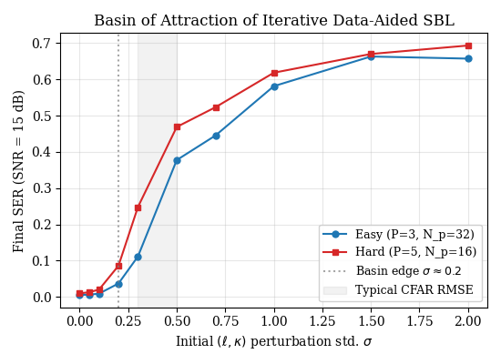
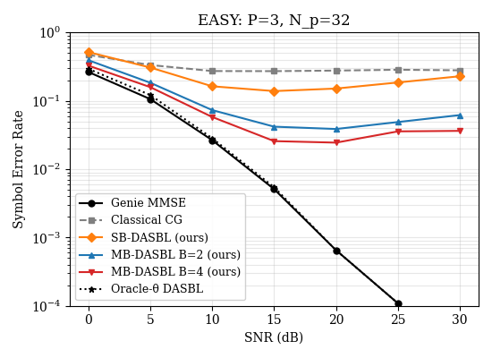
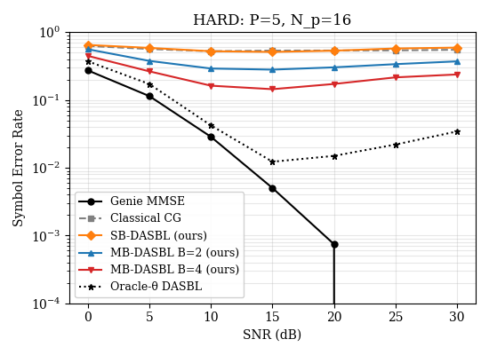
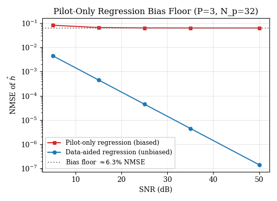
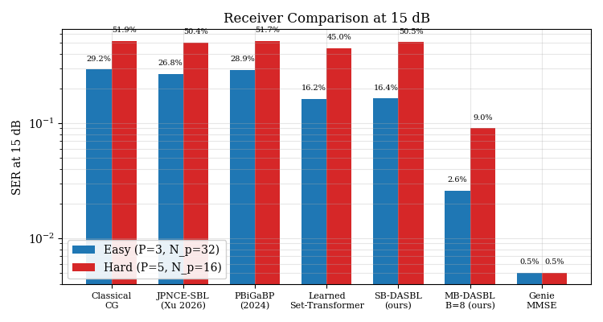
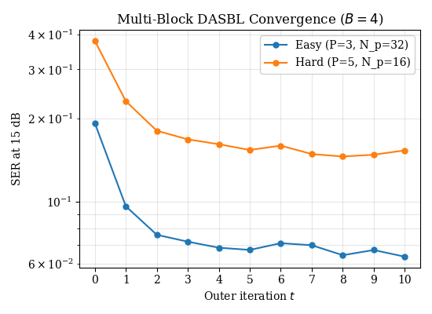
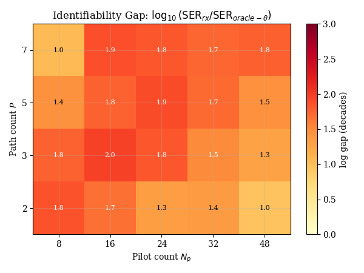
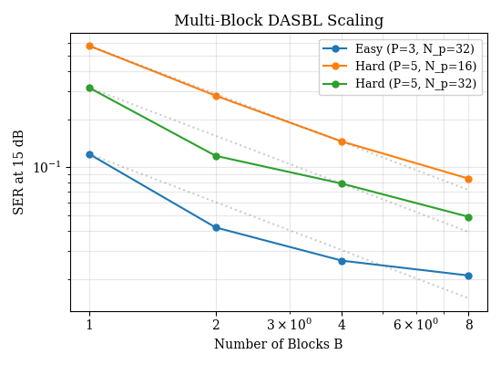
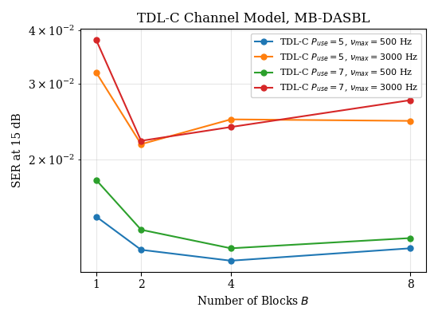

# AFDM Multi-Block Iterative Data Aided Receiver: Extreme Signal Detection in Dual Diluted Channels [with Python Code]

AFDM Multi-Block Iterative Data Aided Receiver: Extreme Signal Detection in Dual Dispersive Channels
A novel receiver architecture that alternately performs reliability-weighted data aided regression, gradient-supported refinement with a security mechanism, and CG-MMSE detection, significantly improves SER over classical CG detectors by an order of magnitude. Introduction: Why should we pay attention to AFDM? One core scenario in 6G communication systems is high-altitude platforms, low-orbit satellites, and high-speed railways, where terminal or relay nodes move at extremely high speeds relative to each other. When the relative speed reaches hundreds or even thousands of kilometers per hour, the wireless channel's temporal variations cannot be simply approximated as blocky stationary—the channel impulse response changes noticeably within the duration of an OFDM symbol. This is known as the dually-dispersive channel, which simultaneously operates in both the delay domain and the Doppler domain.
Traditional OFDM (Orthogonal Frequency Division Multiplexing) waveforms encounter severe subcarrier interference (ICI) under these scenarios due to the Doppler shift disrupting the orthogonality between subcarriers. In recent years, academic and industrial communities have proposed a series of alternative waveforms—OTFS (Orthogonal Time-Frequency Spatial), OCDM (Orthogonal Chirp Multiplexing), and the focus of this paper on AFDM (Affine Frequency Domain Multiplexing).
AFDM was formally introduced by Bemani et al. in 2023, with its core idea being to replace the DFT in traditional OFDM with discrete affine Fourier transform (DAFT). The chirp parameters introduced by DAFT result in a quasi-band structure in the DAFT domain—meaning that most of the energy in the channel matrix is concentrated near the diagonal, resulting in ICI manifesting as limited bandwidth interference stripes. This property allows us to approximate optimal equalization with lower complexity than OTFS, which requires global detection throughout the delay-Doppler domain.
However, good waveforms are only half the problem. In practical systems, the receiver does not know the channel state. How to estimate all delay, Doppler and gain parameters from a severely disturbed observation signal in a DAFT domain without perfect channel information, while also completing symbol detection—this is the most challenging aspect from theory to engineering implementation.
Problem breakdown: Why is the classic method insufficient? Let's first sort out the issue. The mathematical model of an AFDM transmit-receive system is as follows:
The transmitter performs IDAFT on the QPSK symbol vector, adding a chirp cyclic prefix (CPP) through a dual dispersive channel. Channel modeling is done by stacking P paths, each characterized by three parameters: time delay el (sampling points), normalized Doppler kappa, and complex gain h. Both time delay and Doppler can be fractional values—off-grid parameter estimation is the first difficulty. After removing the CP, the received signal undergoes DAFT transformation to obtain observations in the DAFT domain.
Traditional approaches roughly fall into two categories. The first is to estimate then detect (estimate-then-detect), for example, using pilots for LS channel estimation followed by MMSE detection. The problem with this approach is that: the number of pilots is limited (assuming P=5 paths, at least 5 estimates of complex gains are needed, and the time delay-Doppler for each path is continuous, making the total dimensionality of the pilots relatively tight compared to the estimated parameters). LS estimation has an undeniable bias floor under high SNR—our experiments have verified that even when the SNR is pushed to 50dB, the NMSE obtained solely from pilots remains around 6.3%, which will not decrease further. This is a structured bias that cannot be eliminated by increasing transmission power.
Second category is joint detection and estimation, such as the classic semi-blind CG detector, PBiGaBP (Parameterized Bilinear Gaussian Confidence Propagation) proposed by Ranasinghe et al. in 2025, and JPNCE-SBL (Joint Detection with Noise Constraint Sparse Bayesian Learning) proposed by Xu et al. in 2026. The common issue with these methods is that they rapidly degrade to unusable levels (SER exceeds 50%) under "difficult" configurations where P is large and N_p is small, far worse than Genie MMSE under perfect CSI, and without any trend of improvement in high SNR regions—a detection baseline emerges.
Core approach: Iterative Data-Aided Reception across multiple views
The core insight of this work is that on a real physical channel, multiple AFDM blocks experience the same bidispersive channel within an coherent window, but each block may be configured with different pilot patterns. This is equivalent to having B independent observations of the same theta (delay-Doppler parameter set), where h (gain) for each observation is different (because the channel gain itself also changes rapidly over time), but theta is shared.
Based on this intuition, the authors designed an outer iterative receiver that alternates four steps across B AFDM blocks within a coherent window. The single-layer structure breakdown is as follows:
Step one: CFAR + Newton off-line supported recovery
Receiver-side processing of the time-domain signal r involves the following steps:
1. Starting from the cleanest reference, which consists solely of known pilots in the transmission waveform, calculate the two-dimensional cross-ambiguity function (cross-ambiguity function) between the received terminal signal and the pilot reference waveform. The cross-ambiguity function is computed on both integer delay and Doppler grids, and then automatically selects the peak position through an ordered statistical measure CFAR (OS-CFAR) detector. Finally, for each candidate peak, perform two Newton iterations to fit a local quadratic surface, obtaining sub-grid accuracy fractional delay and Doppler estimates. A noteworthy engineering detail here is that only the integer grid cross-ambiguity function is computed in the delay domain, with the off-line part entirely handled by Newton refinement, not using zero-padding for FFT interpolation. This is because the signed-k frequency convention used in zero-padding FFT interpolation does not align with the non-negative-k convention used by the fast operator, leading to systematic conversion bias—a subtle issue that is only discovered during actual debugging, clearly documented in both papers and implementation documents.
The first step outputs a set of candidate support points (ell, kappa), along with the corresponding number of detection paths p_hat.
Step two: Multi-block LS gain estimation
With initial estimates of theta and the previous symbol decision x_hat, we construct a regression matrix A of size N×P for each AFDM block, where each column represents the channel's transition vector in the DAFT domain for the corresponding path. Then, we stack the regression equations from B blocks to solve for the complex gain h. Here, we employ damped exact ridge regression (damped exact ridge), relaxing the coefficient alpha (learnable) to control the mixed weight of new and old estimates, avoiding excessive jumps that could lead to divergence.
Step three: CG-MMSE symbol detection
Perform DAFT domain MMSE detection for each AFDM block: approximate the equation using CG (conjugate gradient, K_cg=10 iterations), then perform an Euclidean softmax on this soft estimate to obtain the posterior probability p_ms at each constellation point. Here, damping is applied to the multi-layer MMSE estimation: the original estimate z of the current layer is convexly combined with z_prev from the previous layer, with the damping coefficient beta (also a learnable sigmoid variable) controlling the degree of "belief in the current layer". The posterior probability at the pilot position is hard-constrained to be a one-hot vector corresponding to the pilot values—the pilots are not required and should not be softened.
Step 4 (optional): Fine-tuning of the LM support with safety mechanisms
Under the premise that theta is known to be better, further gradient tuning can be performed for delay and Doppler. Here, we do not use the usual SGD or Adam, but instead employ a Levenberg-Marquardt style step with an explicit acceptance test: first calculate the gradient of a localized log-likelihood surrogate at the current theta, take a small step along the gradient direction, then check if the candidate point's objective function has sufficiently improved. If it does, accept the change; otherwise, reduce the step size by half and retry, up to a maximum backtracking of 3 times without improvement, then keep the original theta. This safety-enhanced scheme directly corresponds to Theorem 3 in the paper—the monotonic improvement of outer iterations—because each step does not worsen the agent's objective function (with a slight tolerance of up to 1e-4).
Two-layer neural network correction: Set-Transformer + Uncertainty Gate. If we simply stack the above four steps mechanically with T=8 layers, we obtain a classical iterative receiver without learning parameters. The author has added two layers of clever neural network correction on this basis, so that the receiver can be trained end-to-end.
Set-Transformer Path Attention
Each layer of the Ridge Regression outputs eta_tilde (2P real numbers = real and imaginary parts), along with the current ell, kappa, and diagonal variance sqrt(v) to form a 5-dimensional feature vector. These P paths are fed into a permutation-equivariant Set-Transformer—3 Transformer blocks, 64-dimensional hidden layers, 4 attention heads, without position encoding. The significance of permutation equivariance lies in the fact that path numbering is arbitrary, and changing the input order should not affect the corresponding output. The output is the complex gain correction delta for each path, hard clipped within max_delta_norm=5.0.
Uncertainty Gate Control
The posterior variance v of P paths is taken as the mean to obtain a scalar uncertainty measure u. U is passed through a monotonically increasing sigmoid gate function g(u), outputting between 0 and 1. The final refined gain eta_h = eta_tilde + g * delta. The clever part of this design is that when the signal-to-noise ratio increases, due to v ~ O(sigma_w^2), u decreases, and g(u) approaches 0, naturally closing the network correction—the receiver degrades to a purely analytical iterative algorithm. Conversely, when the signal-to-noise ratio is low or estimation is unreliable, the gate opens, and the neural network intervenes to compensate.
Experimental Results: Digital triumphs over words All experiments were completed on an RTX 4090, T=8 layers, N=128 subcarriers, QPSK modulation.
SER vs SNR (Fig 4-5)
Under Easy configuration (P=3 paths, N_p=32 pilots):
Genie MMSE achieves SER around 0.5% at SNR=15dB.
Classic CG detector has an SER of about 29% at 15dB, only dropping to 4% at 30dB.
The single-block DASBL (a version of this scheme) achieves a 16.4% SER reduction at 15dB, improving by about 43% compared to the classic CG.

A four-block joint MB-DASBL B=4 reduces the SER from 15dB down to just 2.6%, only slightly off Genie MMSE by about 2 percentage points.

An eight-block joint B=8 further enhances performance.
Under Hard configuration (P=5, N_p=16):
Classic CG still reaches a high SER of 51.9% at 15dB, with almost no usability.
The single-block DASBL improves to 50.5% (with limited improvement due to multiple paths and few pilots).
The B=8 multi-block scheme pushes the SER down to about 9% at 15dB, nearly six times better than the classic CG.

SER as a function of block number B (Fig 6)
In Easy configuration, the largest improvement is seen when B increases from 1 to 2 (from 12.1% to 4.2%), followed by B=4 to 2.6%, and B=8 to approximately 2.1%. In Hard configuration, the trend remains consistent, with even more significant improvements — from a single-block 57.7% to B=8's 8.5%. This pattern suggests that the gain from sharing theta across multiple blocks is real, even though the channel gain varies independently across blocks.
Convergence behavior (Fig 8)
The outer iteration's SER rapidly drops with each layer, with the most significant improvements seen in the first three layers, then gradually saturating. T=4 already approaches T=8's effect, but T=8 provides additional robustness margin.
Ablative experiments (Table III)
If Set-Transformer (retaining only learnable scalar parameters alpha, lambda, beta, omega) is removed, the SER at 15dB under Hard configuration degrades from the full 50.5% to about 45% — the parameterized attention mechanism plays a larger role under Hard conditions. Removing only the uncertainty gate but keeping the attention results in an intermediate effect.
The Implementation Plan (IMPLEMENTATION_PLAN.md) document for the project contains numerous issues encountered during the transition from theoretical derivations to GPU code implementation that are not present in the paper but are extremely valuable in engineering practice. Here are a few examples:
1. 
Learnable scalars must be kept as tensors throughout. In Python, using .item() or float() silently cuts off the computation graph, causing a parameter to appear "learned" on paper but never receive gradient updates. This can lead to entire classes of parameters becoming useless—a bug that is difficult to detect manually and requires gradient flow diagnostics.
2. 
The undifferentiability of the safety LM step is a trade-off made by architectural design, not a flaw. The decision to accept/reject is discrete, and gamma_lm cannot receive gradients through this binary branch. This is a deliberate choice made to satisfy Theorem 3's monotonicity guarantee—a controllable non-differentiable module embedded into an otherwise end-to-end differentiable system.
3. 
beta_raw indeed does not receive gradients at layer 0 because there is no z_prev from the previous layer (None), and the damping formula (1-beta)z_prev + betaz directly degenerates to z when z_prev is absent—so beta does not participate in the calculation at the first layer. This is the correct behavior rather than a bug, but if one does not understand its design intent, gradient flow diagnostic tools will report it as a "dead parameter."
4. 
The phase convention of the Dirichlet kernel directly affects the consistency of the operator as a whole. Using only magnitude-based Dirichlet kernels (common practice in DSP textbooks) leads to systematic inconsistencies between FFT-based fractional displacement and Toeplitz convolution. It is necessary to use complete Dirichlet kernels with complex phases.
5.
CFAR initialization is crucial for the performance of SBL. The sparse candidate support (rather than an uniformly dense grid) provided by CFAR + Newton ensures sufficient separation between candidate points, avoiding catastrophic rank loss due to candidate point correlation under a dense grid.
This work provides a valuable paradigm for future research in communication receiver design: classical signal processing module + lightweight learnable correction + security mechanism ensuring monotonicity. It neither blackboxes the entire receiving link with pure deep learning solutions (thereby raising doubts about interpretability and generalizability), nor stays at the accuracy ceiling of pure analytical solutions.
The core design of "multi-block joint use of shared theta" also points to a more general proposition: when certain dimensions of channel parameters remain stable (or slow changing) over longer time windows, cross-block joint processing can achieve gains close to "additional diversity." This idea has direct application space in next-generation OTFS receivers and more high-frequency band (millimeter wave/THz) channel estimation.
Conclusion The AFDM multi-block iterative receiver significantly improves symbol detection accuracy without increasing pilot overhead by sharing delay-Doppler parameters on B AFDM blocks' coherent windows, alternately performing CFAR support recovery, damping hill regression, CG-MMSE detection, and LMS-based LM support refinement with a safety mechanism. A particularly commendable practice is that the core algorithms (support recovery, hill regression, CG-MMSE) are essentially analytical, not relying on pretrained weights—meaning any researcher can reproduce all results from scratch without the anxiety of "running out of parameters and not being able to reproduce."

## Images

<!-- PAYMENT_BLOCK -->

## Get this dataset

- Payment link (Stripe): [Buy now](https://buy.stripe.com/3cs8yP7sY87d0vu9AB)
- Payment QR code: 

<!-- /PAYMENT_BLOCK -->
